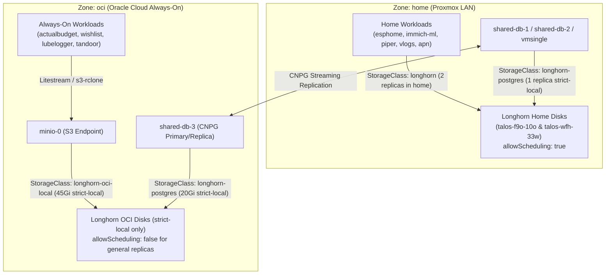

# ADR 003: Storage Strategy

**Status:** Implemented (Updated 2026-10-16 — WAN Block Replication Disabled per [[008-cloudnativepg-migration]] and `IAAC-9`)

## Context
Stateful workloads in our hybrid Talos Kubernetes cluster (`home` Proxmox + `oci` Oracle Cloud) require reliable storage without incurring 30–50ms synchronous WAN block write latency across WireGuard KubeSpan.

## Decision
- **Provider:** We use **Longhorn** (`v1.12.1`) for block storage and **CSI Rclone** (`s3-rclone`) + **Litestream** for S3-backed cloud persistence.
- **No Synchronous WAN Block Replication (`IAAC-9`):**
  - General replica scheduling (`allowScheduling: false`) is disabled on OCI nodes (`talos-cp-oci` and `talos-cp-oci-2`), confining default `longhorn` (`numberOfReplicas = 2`) replicas strictly to the two `home` worker nodes (`talos-f9o-10o` and `talos-wfh-33w`).
  - `replicaZoneSoftAntiAffinity = "true"` (in Longhorn's terminology, `true` means *soft* zone anti-affinity, allowing both replicas to be scheduled within the `home` zone when `oci` is unschedulable; setting it to `false` enforces *hard* zone anti-affinity and blocks same-zone replica placement).
  - `defaultDataLocality = "best-effort"` and `replicaAutoBalance = "best-effort"`.
- **Storage Classes:**
  1. `longhorn` (Default): `numberOfReplicas = 2`, `dataLocality = best-effort`. Replicated exclusively across the two `home` worker nodes (`talos-f9o-10o` and `talos-wfh-33w`).
  2. `longhorn-postgres`: `numberOfReplicas = 1`, `dataLocality = strict-local`, `volumeBindingMode = WaitForFirstConsumer`. Used for CloudNativePG (`shared-db-1`, `shared-db-2`, `shared-db-3`) and `vmsingle` where replication or durability is handled at the application layer or where strict local I/O is required.
  3. `longhorn-oci-local`: `numberOfReplicas = 1`, `dataLocality = strict-local`. Used by `minio-0` on `talos-cp-oci` (`/var/mnt/oci-disk`).
  4. `s3-rclone`: ReadWriteMany object storage mounts backed by local MinIO (`minio.default.svc.cluster.local:9000`), asynchronously synced to QNAP NAS (`[[017-s3-replication-qnap]]`).
- **Backups:** A Longhorn `RecurringJob` (`daily-backup`) backs up labeled volumes daily to S3, while secrets are injected dynamically via `bitwarden-secrets`.

## Architecture Diagram

## Consequences
- **Zero WAN Block Latency:** Home workloads (`apn-mariadb`, `vlogs`, `esphome`, `immich-ml`, `piper`) write exclusively to local NVMe/SSD storage in `home` without waiting for WAN round-trips to OCI.
- **Independent Always-On OCI Tier:** OCI workloads rely on `shared-db-3` (CNPG streaming replication) and `minio-0` (`Litestream` + `s3-rclone`), surviving complete home power/internet outages (`[[035-hybrid-zone-workload-policy]]`).
