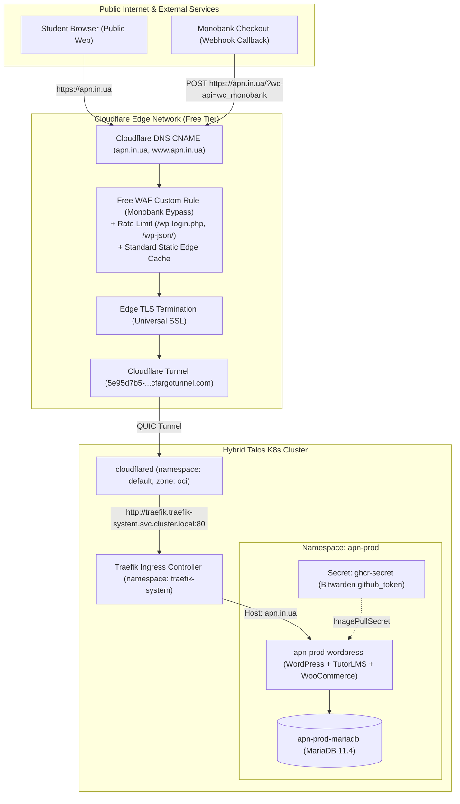

# 025 Production Public Ingress, TLS, and DNS for APN Educational Platform

**Status:** Accepted (Updated 2026-10-29 for `apn.in.ua` & `apn-prod` under IAAC-1 / IAAC-6)
**Date:** 2026-09-22 (Updated 2026-10-29)
**Related Docs:** [[002-networking-and-ingress]], [[030-apn-environment-segregation-and-symlinks]]

## Context

The **APN** educational platform (`WordPress + WooCommerce + TutorLMS + MariaDB`) runs Staging in the `apn` namespace (`apn.kms-lab.in.ua`, restricted to internal LAN/VPN access) and Production in the isolated `apn-prod` namespace (see [[030-apn-environment-segregation-and-symlinks]]).

To launch the public platform and interactive pricing calculator (`https://apn.in.ua/calculator/`) and process automated student enrollments on the official domain **`apn.in.ua`**, APN requires:
1. A production public domain (`apn.in.ua` and `www.apn.in.ua`) accessible over the Internet without VPN.
2. Production TLS termination with valid, trusted certificates (Cloudflare Edge Universal SSL) at $0 cost (`Free Website` tier).
3. Public ingress routing via Cloudflare Tunnel (`cloudflared`) to Traefik and the `apn-prod` namespace.
4. Free-tier Cloudflare WAF protection, rate limiting on `/wp-login.php` and `/wp-json/`, and a WAF bypass for **Monobank Checkout** asynchronous payment webhooks (`/?wc-api=wc_monobank`).
5. Declarative `ghcr-secret` (`kubernetes.io/dockerconfigjson`) in `apn-prod` for pulling versioned release images (`ghcr.io/reidmaks/apn:v*`).

## Architecture & Topology

## Architectural Decisions

### 1. Ingress & Exposure Strategy (Cloudflare Tunnel — Declarative Config)
In accordance with [[002-networking-and-ingress]], we use the cluster's **Cloudflare Tunnel (`cloudflared`)**:
- **Zero Inbound Ports:** No public ports are opened on the home router or Proxmox gateway.
- **Declarative Tunnel Routing (`workload/cloudflare.tf`):** `cloudflare_zero_trust_tunnel_cloudflared_config.main` manages all tunnel public hostnames in code, routing `apn.in.ua` and `www.apn.in.ua` (alongside existing `*.kms-lab.in.ua` public apps) to `http://traefik.traefik-system.svc.cluster.local:80`.
- **Trusted Forwarded Headers:** Traefik (`workload/infrastructure.tf`) trusts cluster CIDR `10.0.0.0/8`, preserving `X-Forwarded-Proto: https` and `CF-Connecting-IP` from `cloudflared` to `apn-prod`.

### 2. Free-Tier TLS, WAF, Rate Limiting & Static Caching (`workload/cloudflare.tf`)
All edge capabilities strictly use **Cloudflare Free Plan (`Free Website`)** features at $0 cost:
- **Edge TLS:** Cloudflare Universal SSL terminates HTTPS (TLS 1.2/1.3) at the edge and forwards HTTP over the encrypted QUIC tunnel to `cloudflared` -> `traefik:80`. No public HTTP-01 challenge on port 443 is needed in `apn-prod`.
- **WAF Custom Rule (`cloudflare_ruleset.apn_waf_custom`):** Uses 1 of the 5 free custom rules in phase `http_request_firewall_custom` to `skip` `http_ratelimit` and `http_request_firewall_managed` when `http.request.uri.query contains "wc-api=wc_monobank"`.
- **Rate Limiting (`cloudflare_ruleset.apn_rate_limit`):** Uses the 1 free rate-limiting rule in phase `http_ratelimit` (`characteristics = ["cf.colo.id", "ip.src"]`, `period = 10`, `requests_per_period = 20`, `mitigation_timeout = 10`, `action = "block"`) to protect `/wp-login.php` and `/wp-json/`.
- **Anti-Spoofing Email DNS Records (`SPF`, `DMARC`, `DKIM`):** Strict `TXT` records (`v=spf1 -all`, `_dmarc` with `p=reject`, and `*._domainkey` with `v=DKIM1; p=`) protect `apn.in.ua` against email spoofing until a production transactional SMTP provider is configured.
- **Static Asset Caching:** Cloudflare Free automatically caches static extensions (`.css`, `.js`, `.woff2`, `.png`, `.webp`, `.svg`, `.ico`) on proxied CNAME records while bypassing dynamic HTML (`/wp-admin/*`, `/checkout/*`, `/cart/*`, `/my-account/*`).

### 3. Declarative ImagePullSecret in `apn-prod` (`workload/ci_runner.tf`)
- `kubernetes_secret.apn_prod_ghcr_secret` provisions `ghcr-secret` in `apn-prod` using `data.bitwarden-secrets_secret.github_token.value`.

## Implementation Checklist

- [x] **Domain Selection & Registration:** `apn.in.ua` registered and delegated to Cloudflare (`jen.ns.cloudflare.com`, `kipp.ns.cloudflare.com`).
- [x] **Cloudflare Token Scope:** Expanded Bitwarden token (`d2256848-eef6-411c-a864-b49300adc052`) to include `apn.in.ua` (`Zone:Read`, `DNS:Edit`, `WAF:Edit`) and `Cloudflare Tunnel:Edit`.
- [x] **DNS, Tunnel & WAF/RateLimit in Terraform:** Configured in `workload/cloudflare.tf`.
- [x] **GHCR Pull Secret in `apn-prod`:** Configured in `workload/ci_runner.tf`.
- [ ] **Production Workload Rollout (`APN-149` / `APN-150`):** Deploy `apn-prod` Helm releases and initialize DB snapshot in the `APN` repository.
