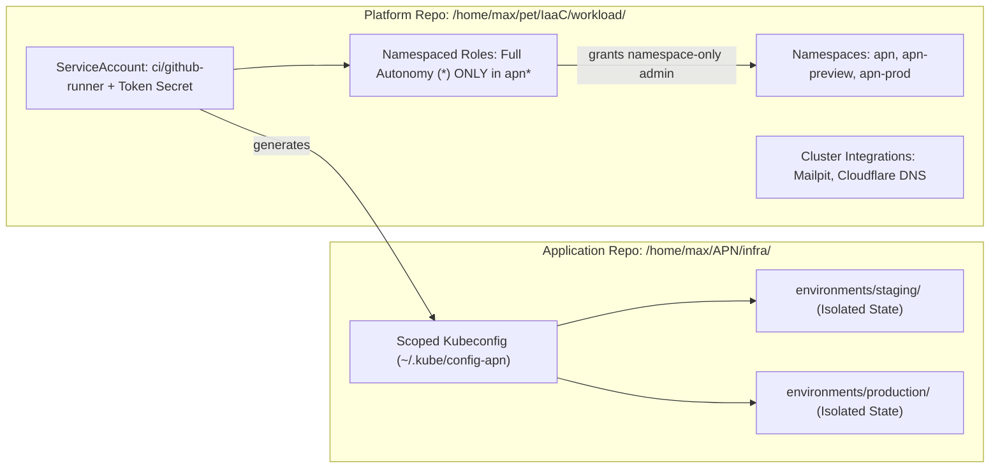

# 030 APN Environment Segregation and Namespace-as-a-Service Sandbox

**Status:** Accepted (Updated 2026-10-17)
**Date:** 2026-10-05
**Related Docs:** [[025-apn-public-ingress-and-dns]], [[027-apn-pr-preview-and-ci-runner]], [[029-apn-performance-optimization-redis-mariadb]]
**References:** APN PR #76 (Platform Simplification, APN-109, APN-131, APN-121)

## Context

Initially, the central `IaaC` repository integrated `APN` staging manifests via cross-repository filesystem symlinks (`workload/apn.tf` $\rightarrow$ `/home/max/APN/infra/environments/staging/apn_staging.tf`). This caused two major operational issues:
1. **Broken CI Validation:** Cloud GitHub Actions runners executing `terraform validate` in `IaaC/workload` lacked `/home/max/APN`, causing dangling symlinks and unresolved resource references (`kubernetes_namespace.apn`, `kubernetes_persistent_volume_claim.apn_*`).
2. **State Coupling vs. Security:** Sharing a single root Terraform state in `IaaC/workload` forced every change in the rapidly evolving `APN` project to go through `IaaC`, whereas granting `APN` full cluster access (`cluster-admin`) violated the Principle of Least Privilege (PoLP).

## Architectural Decision: Namespace-as-a-Service (Sandbox Isolation)

### 1. Platform Boundary (`IaaC/workload`)
- All cross-repository symlinks (`workload/apn.tf`, `workload/helm_values/apn_*.yaml`) are permanently removed from `IaaC`.
- `workload/ci_runner.tf` provisions the three isolated APN sandbox namespaces (`apn`, `apn-preview`, `apn-prod`) with `baseline` Pod Security Standards.
- `workload/ci_runner.tf` binds `kubernetes_service_account.github_runner` (and its token secret `ci/apn-deployer-token`) to namespaced `Role` objects (`api_groups = ["*"]`, `resources = ["*"]`, `verbs = ["*"]`) strictly inside `apn`, `apn-preview`, and `apn-prod`.
- The ServiceAccount has **zero `ClusterRole` write permissions** and cannot access `default`, `kube-system`, `cnpg-system`, or `longhorn-system`.

### 2. Application Autonomy (`APN/infra`)
- `APN` manages its own Terraform states (`infra/environments/staging/` and `infra/environments/production/`) using a namespace-scoped `kubeconfig` (`~/.kube/config-apn`) derived from `ci/apn-deployer-token`.
- Existing staging resources (`random_password`, `kubernetes_secret.apn_secrets`, `kubernetes_config_map.apn_mariadb_config`, `kubernetes_persistent_volume_claim.apn_*`, `helm_release.apn_*`) were detached from `IaaC/workload` via Terraform 1.7+ `removed { lifecycle { destroy = false } }` blocks and migrated into `APN`'s isolated state with zero downtime.
