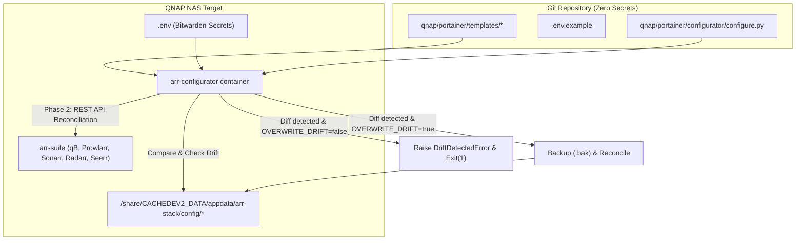

# ADR 033: Media Stack Configuration as Code & Auto-Wiring

## Context
As documented in [[004-qnap-nas]], the media workloads (`qbittorrent`, `sonarr`, `radarr`, `prowlarr`, `lidarr`, `bazarr`, `seerr`, `cross-seed`, `jellyfin`) run via Docker Compose on the QNAP NAS.
Previously, initial bootstrapping required manual browser-based configuration:
- Copying and syncing generated API keys between Prowlarr, Sonarr, Radarr, Lidarr, and Cross-seed.
- Manually adding download clients (`qbittorrent`) into multiple *arr applications.
- Manually connecting Seerr to Jellyfin, Sonarr, and Radarr (which historically led to misconfigurations like erroneous `baseUrl` routing).
- Keeping configurations purely on disk without Git version control risked drift and made disaster recovery or new environment bootstrapping tedious.

## Decision
1. **Configuration Templates in Git (`qnap/portainer/templates/`)**:
   - Store sanitized configuration templates for all services (`cross-seed`, `qbittorrent`, `sonarr`, `radarr`, `prowlarr`, `lidarr`, `seerr`) in the repository.
   - All credentials, API keys, password hashes, and notification tokens are abstracted into environment variables (e.g. `${SONARR_API_KEY}`, `${RADARR_API_KEY}`, `${QBITTORRENT_WEBUI_HASH}`).
   - An environment file template (`qnap/portainer/.env.example`) is provided; production secrets are supplied out-of-band via `.env` (fetched from Bitwarden).

2. **One-Shot Bootstrapper & Drift Reconciler (`arr-configurator`)**:
   - Introduce an `arr-configurator` service (`python:3.11-alpine`) running `configure.py`.
   - **Phase 1 (Pre-flight / Template & Drift Reconciliation)**:
     - Renders configuration templates using environment variables supplied via `.env`.
     - Compares rendered templates against existing files on disk.
     - If in sync: logs `[IN_SYNC]` and proceeds without mutation.
     - If drift is detected: logs a unified diff showing exact differences. By default, it raises `DriftDetectedError` and halts with non-zero exit code to prevent accidental overwrites.
     - Automatically parses and reconciles JSON/XML settings (e.g. cleans erroneous `baseUrl` and enforces direct container DNS hostnames in Seerr).
   - **Phase 2 (Active REST API Reconciliation)**:
     - Waits for services to become healthy.
     - Reconciles `qbittorrent` as the Download Client in Sonarr and Radarr (creates if missing, or checks fields for drift).
     - Reconciles Sonarr and Radarr integration into Prowlarr for automatic indexer synchronization (creates if missing, or checks fields for drift).
   - **Drift Safety & Resolution Workflow**:
     - By default (`OVERWRITE_DRIFT=false`), any detected drift raises `DriftDetectedError` with a complete diff report.
     - This requires an explicit decision from the operator:
       1. **Adopt into Code**: Update templates or variables in Git to match the live environment.
       2. **Enforce Code**: Set `OVERWRITE_DRIFT=true` in `.env` (or pass `--overwrite-drift`) to overwrite running state with code (timestamped `.bak` files are automatically created).

## Consequences
- **Pros**:
  - Full reproducible disaster recovery from scratch with zero manual UI copy-pasting.
  - Zero secrets in Git (100% compliant with project security policies).
  - Strict GitOps safety: detects configuration drift without silent overwrites, demanding explicit operator choice.
  - Clear unified diff output directly in container/deployment logs.
- **Cons**:
  - Requires maintaining templates in sync with major upstream configuration schema changes.
