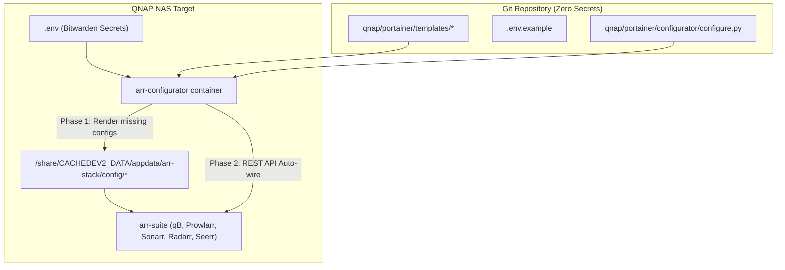

# ADR 033: Media Stack Configuration as Code & Auto-Wiring

## Context
As documented in [[004-qnap-nas]], the media workloads (`qbittorrent`, `sonarr`, `radarr`, `prowlarr`, `lidarr`, `bazarr`, `seerr`, `cross-seed`, `jellyfin`) run via Docker Compose on the QNAP NAS.
Previously, initial bootstrapping required manual browser-based configuration:
- Copying and syncing generated API keys between Prowlarr, Sonarr, Radarr, Lidarr, and Cross-seed.
- Manually adding download clients (`qbittorrent`) into multiple *arr applications.
- Manually connecting Seerr to Jellyfin, Sonarr, and Radarr (which historically led to misconfigurations like erroneous `baseUrl` routing).
- Keeping configurations purely on disk without Git version control risked drift and made disaster recovery or new environment bootstrapping tedious.

## Decision
1. **Configuration Templates in Git (`qnap/portainer/templates/`)**:
   - Store sanitized configuration templates for all services (`cross-seed`, `qbittorrent`, `sonarr`, `radarr`, `prowlarr`, `lidarr`, `seerr`) in the repository.
   - All credentials, API keys, password hashes, and notification tokens are abstracted into environment variables (e.g. `${SONARR_API_KEY}`, `${RADARR_API_KEY}`, `${QBITTORRENT_WEBUI_HASH}`).
   - An environment file template (`qnap/portainer/.env.example`) is provided; production secrets are supplied out-of-band via `.env` (fetched from Bitwarden).

2. **One-Shot Bootstrapper (`arr-configurator`)**:
   - Introduce an `arr-configurator` service (`python:3.11-alpine`) running `configure.py`.
   - **Phase 1 (Pre-flight / Template Rendering)**:
     - Non-destructive: If configuration files already exist on the target storage, it leaves them untouched (`[SKIP]`).
     - On a fresh deploy, it substitutes environment variables into the templates and writes ready-to-run configs with appropriate permissions.
     - Automatically validates and corrects known discrepancies (e.g. cleans erroneous `baseUrl` in Seerr).
   - **Phase 2 (Auto-Wiring via REST API)**:
     - Waits for services to become healthy.
     - Idempotently adds `qbittorrent` as the Download Client in Sonarr, Radarr, and Lidarr if missing.
     - Idempotently links Sonarr, Radarr, and Lidarr into Prowlarr for automatic indexer synchronization.

## Consequences
- **Pros**:
  - Full reproducible disaster recovery from scratch with zero manual UI copy-pasting.
  - Zero secrets in Git (100% compliant with project security policies).
  - Safe and idempotent on existing running deployments without risk of overwriting active state or tokens.
- **Cons**:
  - Requires maintaining templates in sync with major upstream configuration schema changes.
