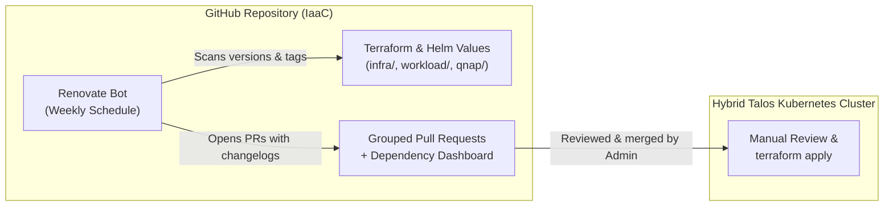

# 034 Declarative Dependency & Image Updates via Renovate Bot

**Status:** Accepted
**Date:** 2026-10-14
**Supersedes:** [[026-keel-image-automation]]

## Context

Previously, the cluster ran two in-cluster pods for tracking and applying container updates:
1. **Diun (`default/diun`)**: Watched running Kubernetes pods and sent push notifications to `ntfy.sh` when newer image digests appeared.
2. **Keel (`kube-system/keel`)**: Polled container registries and mutated Kubernetes Deployments directly inside the cluster.

During the 2026-10 infrastructure audit (`IAAC-14`, `IAAC-22`), several drawbacks with this approach were identified:
- **Terraform State Drift:** Because all cluster workloads are managed declaratively via Terraform (`workload/*.tf` and `workload/helm_values/*.yaml`), mutating live Deployments in-cluster via Keel caused divergence between Git state and live cluster state.
- **No Helm Chart or Terraform Provider Tracking:** Neither Diun nor Keel tracked updates to Helm chart versions (`helm_release.version`) or Terraform providers (`required_providers`), which represent the majority of our infrastructure dependencies.
- **Hardcoded Notification Topic & In-Cluster Overhead:** Both services had a hardcoded `ntfy.sh` topic in Git and consumed cluster memory/CPU plus cluster-wide RBAC permissions (`ClusterRole`) continuously.

## Decision

1. **Decommission Keel and Diun:** Remove `helm_release.keel`, `helm_release.diun`, and associated RBAC resources from `workload/keel.tf` and `workload/diun.tf`, and purge the hardcoded `ntfy.sh` topic from `workload/helm_values/`.
2. **Adopt Renovate Bot (`renovate.json`):** Configure Renovate at the root of the repository to scan and open grouped Pull Requests for:
   - **Terraform Providers & Helm Releases** in `infra/*.tf`, `workload/*.tf`, and `qnap/*.tf`.
   - **Helm Values Container Images** in `workload/helm_values/*.yaml` and `workload/charts/**/values.yaml`.
   - **Inline Terraform Container Images** (`image = "repo:tag"`) via a custom regex manager in `workload/*.tf`.
   - **Docker Compose Images** in `qnap/`.

## Consequences

- **Zero In-Cluster Resource Overhead:** Frees ~95Mi of RAM requests and removes two permanently running pods and their cluster-wide RBAC bindings.
- **True GitOps Alignment:** All version upgrades (Terraform providers, Helm charts, and Docker images) go through Git Pull Requests with release notes and version pinning before `terraform apply`.
- **Secret Hygiene:** Eliminates the hardcoded `ntfy.sh` webhook URL from the repository.

## References
- [[026-keel-image-automation]]
- [[INDEX]]
