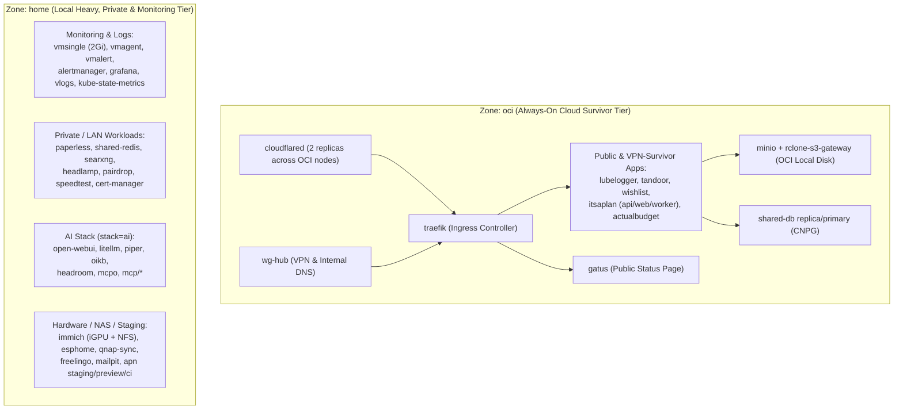

# 035 Hybrid Zone Workload Placement Policy (`oci` vs `home`)

**Status:** Accepted
**Date:** 2026-10-15
**Related Docs:** [[001-hybrid-cluster]], [[002-networking-and-ingress]], [[008-cloudnativepg-migration]], [[011-descheduler-tuning]], [[016-migrate-to-local-minio]], [[031-pin-apn-staging-preview-runners-to-home-zone]]

## Context

Our hybrid Talos Kubernetes cluster spans two failure domains labeled via `topology.kubernetes.io/zone`:
1. **`zone: oci`** (`talos-cp-oci`, `talos-cp-oci-2` — 2x ARM64 Control Plane/Worker nodes on Oracle Cloud, 2 vCPU / 12 GiB RAM each):
   - Always-on cloud environment with independent power and connectivity.
   - Holds 2 of 3 `etcd` members so the Kubernetes control plane survives complete home power/internet blackouts.
2. **`zone: home`** (`talos-b7w-rgq` CP, `talos-f9o-10o` 6 vCPU / 12 GiB RAM, `talos-wfh-33w` 4 vCPU / 12 GiB RAM + Intel iGPU):
   - High-capacity local Proxmox hardware connected to the QNAP NAS (`192.168.0.0/24`), subject to potential residential power or ISP outages.

When Kubernetes Descheduler (`LowNodeUtilization`, [[011-descheduler-tuning]]) was enabled without explicit `nodeSelector` rules on all workloads:
- Publicly exposed workloads (`lubelogger`, `wishlist`, `itsaplan-web`, `itsaplan-worker`) were evicted from `oci` to `home`, meaning a home power outage would immediately take down public websites for at least the 5-minute node eviction timeout.
- Conversely, heavy private workloads (`paperless`, `victoriametrics`, `grafana`, `vmagent`, `vmalert`) remained scheduled on `oci`, consuming ~660m CPU requests and >2 GiB RAM on the 2-vCPU OCI nodes.

## Decision

We enforce an explicit two-tier zone placement policy across `workload/`:

### 1. `zone: oci` — Always-On Cloud Survivor Tier (`topology.kubernetes.io/zone: oci`)
Pinned strictly to `oci` so public and critical VPN-accessible services experience **zero downtime** when the `home` zone loses power or internet:
- **Ingress & Connectivity:** `wg-hub` (`talos-cp-oci`), `traefik`, `cloudflared` (2 replicas spread across `talos-cp-oci` and `talos-cp-oci-2`).
- **Public Services (`workload/cloudflare.tf`):** `gatus`, `lubelogger`, `tandoor`, `wishlist`, `itsaplan` (`api`, `web`, `worker`).
- **Intranet/VPN Survivor Services:** `actualbudget` (accessible via WireGuard VPN `wg-hub` during home outages; backed by Litestream + MinIO in `oci`, not exposed via public Cloudflare Tunnel).
- **Cloud-Local Backing Storage:** `minio` (`talos-cp-oci`), `rclone-s3-gateway` (`oci`), and one `shared-db` CloudNativePG instance.

### 2. `zone: home` — Private, Heavy Compute, Monitoring & AI Tier (`topology.kubernetes.io/zone: home`)
Pinned strictly to `home` to keep OCI CPU and RAM free for the survivor tier and co-locate heavy workloads with local storage/GPU:
- **Monitoring & Logging (`monitoring`):** `vmsingle` (resized from `1Gi` to `2Gi` on `longhorn-postgres` to resolve `KubePersistentVolumeFillingUp`), `vmagent`, `vmalert`, `alertmanager`, `vm-grafana`, `vlogs`, `kube-state-metrics`, `victoria-metrics-operator`. Disabled unreachable localhost control-plane scrape targets (`kubeControllerManager`, `kubeScheduler`, `kubeEtcd`) on Talos Linux.
- **Private / Internal Apps:** `paperless`, `shared-redis`, `searxng`, `headlamp`, `pairdrop`, `speedtest`, `cert-manager`.
- **AI Stack (`stack=ai`):** `open-webui`, `litellm`, `piper`, `oikb`, `headroom`, `mcpo`, `mcp` (`kubernetes-mcp`, `prometheus-mcp`, `grafana-mcp`).
- **Local Hardware / Staging:** `immich`, `esphome`, `qnap-sync`, `freelingo`, `mailpit`, `apn` (staging, preview, `ci-runner`).

### 3. Longhorn Engine Auto-Upgrade (`concurrentAutomaticEngineUpgradePerNodeLimit = 1`)
Enabled automatic engine upgrades in `workload/infrastructure.tf` so Longhorn automatically migrates attached volumes to the current engine image (`v1.12.1`) and retires old `instance-manager` pods (freeing `234m` CPU requests on `talos-cp-oci-2`).

### 4. Right-Sizing Memory Limits from 7-Day OOMKill Audit
Before recreating `vmsingle`'s local PVC on `home`, a 7-day PromQL audit identified three containers that had experienced `OOMKilled` events under peak load:
- `default/minio-0`: raised `limits.memory` from `512Mi` to `768Mi`.
- `management/itsaplan-api`: raised `limits.memory` from `512Mi` to `768Mi`.
- `wg-hub` (`ingress-80` and `ingress-443` `socat` containers): raised `limits.memory` from `32Mi` to `128Mi`.

### 5. Runtime Worker, Garbage Collector & Allocator Tuning (2026-10-19)
To reduce steady-state RSS memory across both `oci` and `home` zones without reducing request concurrency:
- **`Tandoor` (`workload/helm_values/tandoor.yaml`):** Replaced default 3 Gunicorn worker processes (~855 MiB RSS) with `GUNICORN_WORKERS=1`, `GUNICORN_THREADS=4`, `PYTHONOPTIMIZE=1`, `MALLOC_TRIM_THRESHOLD_=65536`, `MALLOC_ARENA_MAX=2`, and lowered `requests.memory` from `1Gi` to `256Mi` (`limits.memory: 768Mi`).
- **`Immich` (`workload/helm_values/immich.yaml`):** Added `MALLOC_TRIM_THRESHOLD_=65536`, `MALLOC_ARENA_MAX=2` (for `sharp`/`libvips` and OpenVINO), `NODE_OPTIONS=--max-old-space-size=512`, and `PYTHONOPTIMIZE=1`.
- **`Authentik` (`workload/helm_values/authentik.yaml`):** Set `AUTHENTIK_WEB__WORKERS=1`, `AUTHENTIK_WEB__THREADS=4`, `PYTHONOPTIMIZE=1`, `MALLOC_TRIM_THRESHOLD_=65536`, and `MALLOC_ARENA_MAX=2`.
- **`Paperless-ngx` & `SearXNG` (`workload/helm_values/paperless.yaml`, `workload/helm_values/searxng.yaml`):** Added `PYTHONOPTIMIZE=1`, `MALLOC_TRIM_THRESHOLD_=65536`, and `MALLOC_ARENA_MAX=2`.
- **`LubeLogger` (`workload/helm_values/lubelogger.yaml`):** Added `.NET` Workstation GC (`DOTNET_gcServer=0`, `DOTNET_GCConserveMemory=9`) and `glibc` arena limits (`MALLOC_TRIM_THRESHOLD_=131072`, `MALLOC_ARENA_MAX=2`).
- **`Wishlist` (`workload/helm_values/wishlist.yaml`):** Bounded Node.js V8 heap (`NODE_OPTIONS=--max-old-space-size=128`, `MALLOC_ARENA_MAX=2`) and lowered `requests.memory` from `256Mi` to `128Mi`.

## Consequences
- **Resilience to Home Blackouts:** All public endpoints and `actualbudget` (over VPN) remain 100% operational in OCI with their ingress (`cloudflared`, `traefik`) and storage (`minio`, `shared-db`) co-located in the cloud.
- **Safe Descheduler Operation:** Descheduler balances pods *within* their designated zone (`talos-cp-oci` <-> `talos-cp-oci-2` in `oci`, and `talos-f9o-10o` <-> `talos-wfh-33w` in `home`) without ever crossing the zone boundary for pinned services.
- **OCI & Home Headroom:** Moving `paperless` and `monitoring` to `home` plus tuning Python/Node.js/.NET runtimes frees ~3.5+ GiB of combined RAM across `oci` and `home` nodes.
