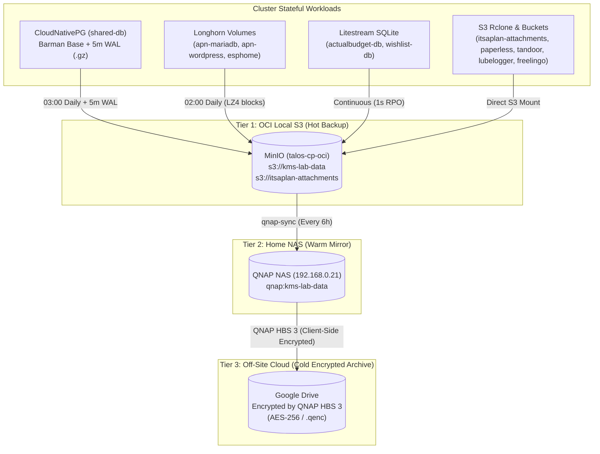

# ADR 036: Disaster Recovery (DR) & Backup Restore Runbook

**Status:** Active (Verified 2026-10-17)
**Date:** 2026-10-17

## Context
Our hybrid Talos Kubernetes cluster (`home` Proxmox + `oci` Oracle Cloud) implements a **3-2-1 backup architecture** across three storage tiers:
1. **Tier 1 — In-Cluster S3 (`minio-0` on `talos-cp-oci`):** Single source of truth for all cluster backups (`s3://kms-lab-data` and `s3://itsaplan-attachments`).
2. **Tier 2 — Local NAS (`QNAP NAS` at `192.168.0.21:8010`):** Asynchronously mirrored every 6 hours via the `qnap-sync` CronJob (`[[017-s3-replication-qnap]]`).
3. **Tier 3 — Off-Site Cloud Archive (`Google Drive` via QNAP HBS 3):** QNAP Hybrid Backup Sync (HBS 3) syncs the local QNAP backup directory to Google Drive with **Client-Side Encryption** enabled.

This runbook documents the exact step-by-step procedures to decrypt, verify, and restore every stateful service in the cluster under both partial and catastrophic failure scenarios.

---

## 1. End-to-End Backup & Recovery Pipeline



---

## 2. Stage 1: Restoring the S3 Backup Store (By Disaster Scenario)

All workload recovery mechanisms read from `minio` (`http://minio.default.svc.cluster.local:9000`). Before restoring individual services, ensure `minio` has the backup data according to your failure scenario:

### Scenario A: Service Corruption / Accidental Deletion (MinIO is Healthy)
- **Action:** None required at the storage layer. All backups (`cnpg-backups/`, `longhorn-backups/`, `actualbudget-db/`, `wishlist-db/`) are already present in `minio:kms-lab-data`. Proceed directly to **Stage 2**.

### Scenario B: OCI Node (`talos-cp-oci`) Lost, Home QNAP NAS (`192.168.0.21`) is Healthy
1. Provision the replacement OCI node and deploy `minio` via Terraform (`workload/minio.tf`).
2. Re-hydrate `minio` from QNAP NAS by triggering a reverse `rclone sync` inside the cluster:
   ```bash
   kubectl run rclone-restore --rm -it --restart=Never -n default \
     --image=rclone/rclone:1.67.0 \
     --overrides='{
       "spec": {
         "containers": [{
           "name": "rclone-restore",
           "image": "rclone/rclone:1.67.0",
           "command": ["sh", "-c", "rclone sync qnap:kms-lab-data minio:kms-lab-data --exclude \"/itsaplan-attachments/**\" -P && rclone sync qnap:kms-lab-data/itsaplan-attachments minio:itsaplan-attachments -P"],
           "envFrom": [{"secretRef": {"name": "litestream-s3"}}],
           "env": [
             {"name": "RCLONE_CONFIG_MINIO_TYPE", "value": "s3"},
             {"name": "RCLONE_CONFIG_MINIO_PROVIDER", "value": "Minio"},
             {"name": "RCLONE_CONFIG_MINIO_ENDPOINT", "value": "http://minio.default.svc.cluster.local:9000"},
             {"name": "RCLONE_CONFIG_QNAP_TYPE", "value": "s3"},
             {"name": "RCLONE_CONFIG_QNAP_PROVIDER", "value": "Other"},
             {"name": "RCLONE_CONFIG_QNAP_ENDPOINT", "value": "http://192.168.0.21:8010"}
           ]
         }]
       }
     }'
   ```

### Scenario C: Catastrophic Loss (Both Cluster and QNAP NAS Lost — Restoring from Encrypted Google Drive)

Because QNAP HBS 3 encrypts files on the client side before uploading to Google Drive, files downloaded raw from Google Drive are encrypted (`.qenc` / AES-256-CBC) and **must be decrypted** before MinIO, Longhorn, or Barman can read them.

#### Option C1: Decryption via QNAP NAS (If a QNAP NAS is Available)
1. Open **HBS 3 (Hybrid Backup Sync)** on QNAP.
2. Create a **Restore Job** (or One-Way Sync from Google Drive $\rightarrow$ local QNAP folder `kms-lab-data`).
3. Enter your **HBS 3 Client-Side Encryption Password**. HBS 3 will transparently decrypt all files back into `qnap:kms-lab-data`.
4. Run the command from **Scenario B** to sync `qnap:kms-lab-data` $\rightarrow$ `minio:kms-lab-data`.

#### Option C2: Decryption on Any Linux Workstation / VM (Without QNAP Hardware)
If the QNAP NAS hardware is destroyed or unavailable, decrypt the Google Drive backup directly on Linux:

1. **Download the encrypted directory from Google Drive:**
   ```bash
   mkdir -p /tmp/dr-encrypted /tmp/dr-decrypted
   rclone copy gdrive:K8s-Backups /tmp/dr-encrypted -P
   ```
2. **Decrypt the HBS 3 encrypted files:**
   - **Method 1 — Official QNAP QENC Decrypter (supports both encrypted and compressed `.qenc` files):**
     Download **QENC Decrypter** for Linux (Ubuntu/Debian) from [qnap.com/en-us/utilities/enterprise](https://www.qnap.com/en-us/utilities/enterprise) or use the open-source `QnapBackupDecryptor`, and decrypt the folder tree:
     ```bash
     # Using QENC Decrypter CLI / GUI:
     # Select Source: /tmp/dr-encrypted
     # Select Destination: /tmp/dr-decrypted
     # Enter the HBS 3 encryption password
     ```
   - **Method 2 — Standard OpenSSL CLI (when HBS 3 Sync is configured with Encryption ON and Compression OFF):**
     ```bash
     export HBS_PASS="your-encryption-password"
     cd /tmp/dr-encrypted
     find . -type d -exec mkdir -p "/tmp/dr-decrypted/{}" \;
     find . -type f -exec sh -c '
       out="/tmp/dr-decrypted/${1%.qenc}"
       openssl enc -d -aes-256-cbc -md md5 -in "$1" -out "$out" -pass env:HBS_PASS
     ' _ {} \;
     ```
3. **Upload the decrypted backup tree to MinIO:**
   Port-forward MinIO (`kubectl port-forward -n default svc/minio 9000:9000`) and push the decrypted files:
   ```bash
   rclone sync /tmp/dr-decrypted/kms-lab-data minio:kms-lab-data --exclude "/itsaplan-attachments/**" -P
   rclone sync /tmp/dr-decrypted/kms-lab-data/itsaplan-attachments minio:itsaplan-attachments -P
   ```

---

## 3. Stage 2: Restoring Individual Workloads

### 3.1. CloudNativePG (`shared-db` PostgreSQL Cluster)
Covers: `itsaplan`, `immich`, `paperless`, `tandoor`, `litellm`, `open-webui`, `lubelogger`, `freelingo`.

#### A. Non-Destructive Restore Drill (Side-by-Side Test Cluster)
To test backup integrity and Point-in-Time Recovery (PITR) **without touching the live `shared-db` cluster**, create a temporary 1-node recovery cluster `shared-db-restore-test`:

```yaml
# Save as /tmp/cnpg-restore-test.yaml
apiVersion: postgresql.cnpg.io/v1
kind: Cluster
metadata:
  name: shared-db-restore-test
  namespace: cnpg-system
spec:
  instances: 1
  imageCatalogRef:
    apiGroup: postgresql.cnpg.io
    kind: ClusterImageCatalog
    name: pg18-extensions
    major: 18
  postgresUID: 26
  postgresGID: 26
  storage:
    storageClass: longhorn-postgres
    size: 20Gi
  bootstrap:
    recovery:
      source: shared-db-backup
      # Optional: uncomment recoveryTarget for Point-in-Time Recovery to a specific timestamp
      # recoveryTarget:
      #   targetTime: "2026-10-17 07:30:00.00000+00"
  externalClusters:
    - name: shared-db-backup
      barmanObjectStore:
        destinationPath: s3://kms-lab-data/cnpg-backups
        endpointURL: http://minio.default.svc.cluster.local:9000
        serverName: shared-db
        s3Credentials:
          accessKeyId:
            name: cnpg-minio-s3-creds
            key: ACCESS_KEY_ID
          secretAccessKey:
            name: cnpg-minio-s3-creds
            key: SECRET_ACCESS_KEY
        wal:
          maxParallel: 4
```

Run and verify:
```bash
kubectl apply -f /tmp/cnpg-restore-test.yaml
kubectl get cluster shared-db-restore-test -n cnpg-system -w
# Once STATUS is "Cluster in healthy state", verify databases:
kubectl exec -it -n cnpg-system shared-db-restore-test-1 -c postgres -- psql -U postgres -c "\l+"
# Clean up drill cluster and its PVC after verification:
kubectl delete cluster shared-db-restore-test -n cnpg-system
kubectl delete pvc -n cnpg-system -l cnpg.io/cluster=shared-db-restore-test
```

#### B. Full Production Recovery of `shared-db`
If the entire `shared-db` cluster is lost and must be restored from S3:
1. In `workload/cnpg.tf`, replace the `bootstrap.initdb` block with the `bootstrap.recovery` + `externalClusters` block shown above (note: when restoring into the same cluster name `shared-db` while still archiving to `cnpg-backups`, set `backup.barmanObjectStore.serverName = "shared-db-v2"` so the new timeline does not overwrite the old WAL history).
2. Run `terraform apply` in `workload/`.

---

### 3.2. Longhorn Block Volumes (`apn-mariadb-data`, `apn-wordpress-content`, `esphome-config`)

#### A. Non-Destructive Restore Drill via `kubectl` / Longhorn UI
1. List available backups in `longhorn-system`:
   ```bash
   kubectl get backups.longhorn.io -n longhorn-system -o custom-columns=NAME:.metadata.name,VOLUME:.metadata.labels.backup-volume,SIZE:.status.size,STATE:.status.state,CREATED:.status.snapshotCreatedAt
   ```
2. In the **Longhorn UI** (`https://longhorn.kms-lab.in.ua` $\rightarrow$ **Backup** tab):
   - Select the volume (`esphome-config`, `apn-mariadb-data`, or `apn-wordpress-content`).
   - Click **Restore Latest Backup** and set Name to `restore-test-vol`.
   - Attach `restore-test-vol` to any node to inspect files, then delete `restore-test-vol`.

#### B. Full Production PVC Recovery from Backup
To replace a corrupted PVC (e.g., `esphome-config`):
1. Scale down the workload (`kubectl scale deploy/esphome -n default --replicas=0`).
2. In Longhorn UI $\rightarrow$ **Backup**, restore the latest backup with the exact PVC volume name or create a new PVC referencing `fromBackup` in `StorageClass` parameters, bind it to `esphome-config`, and scale the deployment back to `1`.

---

### 3.3. Litestream SQLite Databases (`actualbudget`, `wishlist`)

#### A. Non-Destructive Restore Verification (Tested 2026-10-17)
Verify that Litestream can reconstruct a valid SQLite database from MinIO S3 at any time by restoring into `/tmp` inside the running pod:

```bash
# Test Wishlist SQLite restore:
kubectl exec -n default deploy/wishlist -c litestream -- sh -c \
  "litestream restore -config /etc/litestream.yml -o /tmp/test_restore.db /usr/src/app/data/prod.db && ls -lh /tmp/test_restore.db && rm -f /tmp/test_restore.db"
```

#### B. Full Production Recovery
Both `actualbudget` and `wishlist` use an automatic initContainer (`01-litestream-restore`) with `-if-replica-exists -if-db-not-exists`.
- For `wishlist` (which uses `emptyDir` for `/usr/src/app/data`), simply restarting the pod (`kubectl rollout restart deploy/wishlist -n default`) automatically downloads and replays the latest SQLite state from `s3://kms-lab-data/wishlist-db`.
- For `actualbudget`, delete the corrupted `.sqlite` file from `/data` and restart the pod (`kubectl rollout restart deploy/actualbudget -n default`); `01-litestream-restore` will automatically restore it from `s3://kms-lab-data/actualbudget-db`.

---

### 3.4. S3 Application Files (`s3-rclone` & `itsaplan-attachments`)
Covers: `itsaplan-attachments`, `paperless-media`, `tandoor-mediafiles`, `lubelogger-files`, `freelingo-data`, `actualbudget-files`, `wishlist-uploads`.

Because these workloads mount MinIO buckets directly (or via `csi-rclone`), restoring them from QNAP NAS (`qnap:kms-lab-data/<folder>`) requires a single `rclone copy` command:
```bash
# Example: Restore a specific folder (e.g. itsaplan-attachments) from QNAP back to MinIO:
kubectl create job --from=cronjob/qnap-sync qnap-restore-manual -n default --dry-run=client -o yaml | \
  sed 's/rclone sync minio:itsaplan-attachments qnap:kms-lab-data\/itsaplan-attachments/rclone copy qnap:kms-lab-data\/itsaplan-attachments minio:itsaplan-attachments/'
```

---

## 4. Disaster Recovery Verification Log

| Date | Component | Test Performed | Result |
| :--- | :--- | :--- | :--- |
| `2026-10-17` | **Litestream (`wishlist-db`)** | Restored `/usr/src/app/data/prod.db` from `s3://kms-lab-data/wishlist-db` into `/tmp/test_restore.db` | **PASS** (`316 KiB` DB restored in `<1s`) |
| `2026-10-17` | **CNPG (`shared-db`)** | Verified `base/20261017T064839` (`1.1 GiB` compressed) + continuous 5-min `.gz` WAL segments in MinIO & QNAP | **PASS** (`firstRecoverabilityPoint` active) |
| `2026-10-17` | **Longhorn (`daily-backup`)** | Verified full backup creation & sync for all 3 volumes (`apn-mariadb-data`, `apn-wordpress-content`, `esphome-config`) to MinIO | **PASS** (`62s` total, `97 MiB` deduplicated) |
