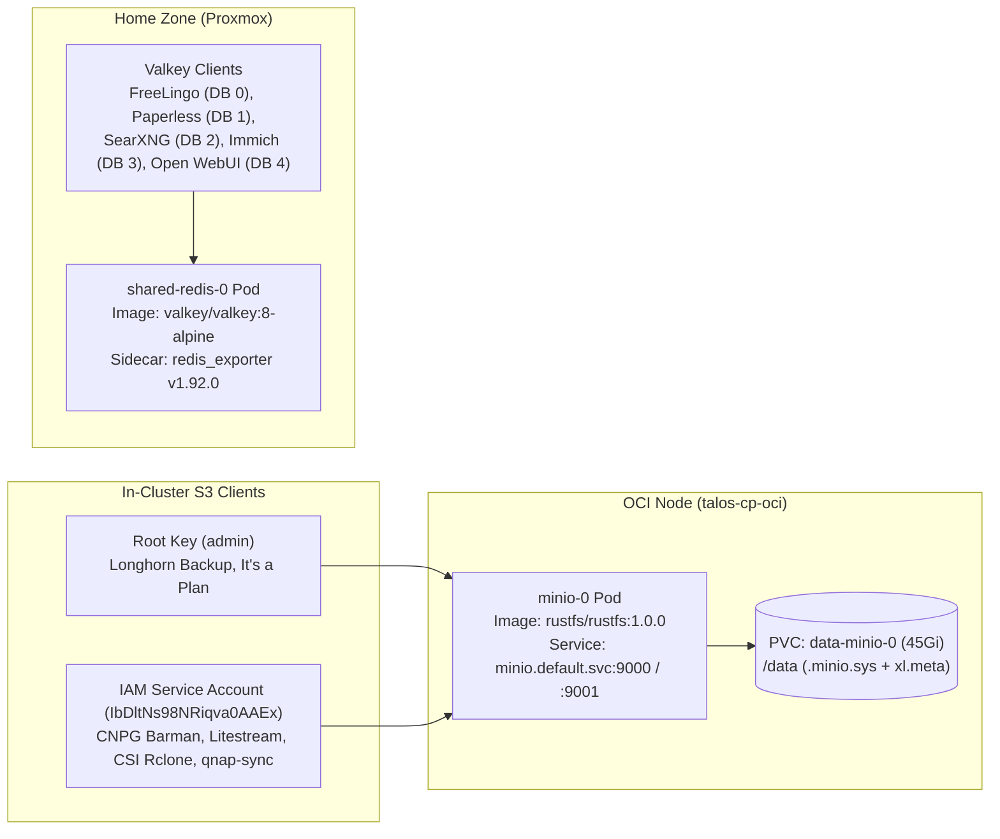

# 037 Drop-in Migration: MinIO to RustFS 1.0 and Redis to Valkey 8

**Status:** Applied (Verified 2026-10-17)
**Date:** 2026-10-17
**Related Docs:** [[013-centralized-grafana-dashboards]], [[016-migrate-to-local-minio]], [[017-s3-replication-qnap]], [[024-itsaplan-ai-issue-tracker]], [[036-disaster-recovery-runbook]]
**Reference:** IAAC-24

## Context

1. **MinIO Community Edition End-of-Life:**
   - The open-source MinIO repository was officially archived without further security patches, and upstream Docker Hub images were removed.
   - Our primary in-cluster S3 store (`workload/minio.tf`) was still running `quay.io/minio/minio:RELEASE.2024-03-30T09-41-56Z`.
   - **RustFS 1.0.0 GA** (`rustfs/rustfs:1.0.0`, Apache 2.0, written in Rust) supports direct in-place (`xl-single` / `xl.meta`) migration on top of an existing MinIO `/data` volume, including decryption and import of `.minio.sys` IAM service accounts and bucket metadata. It is already used in-cluster by the `itsaplan` chart (`[[024-itsaplan-ai-issue-tracker]]`).

2. **Redis Licensing Shift to Valkey:**
   - Following Redis's license change, **Valkey** (Linux Foundation, BSD-3) became the standard open-source drop-in replacement.
   - `workload/redis.tf` (`shared-redis`) and `workload/charts/apn-preview/values.yaml` were still referencing `redis:7-alpine`.

## Architecture & Migration Design

## Decisions

### 1. In-Place MinIO $\rightarrow$ RustFS 1.0.0 Replacement (`workload/minio.tf`)
- **Service & Storage Continuity:** Preserved the `helm_release` name (`minio`), Kubernetes Service (`minio.default.svc.cluster.local:9000` and `:9001`), Ingresses (`s3.kms-lab.in.ua`, `s3-ui.kms-lab.in.ua`), and the existing `45Gi` `longhorn-oci-local` PVC mounted at `/data`. Zero client reconfiguration is required.
- **IAM Service Account Decryption:** Provided both `RUSTFS_ACCESS_KEY` / `RUSTFS_SECRET_KEY` and `MINIO_ROOT_USER` / `MINIO_ROOT_PASSWORD` in `minio-secret` with the exact original root credentials (`admin`), enabling RustFS 1.0.0 (`rustfs#4358`) to decrypt `.minio.sys/config/iam/service-accounts/IbDltNs98NRiqva0AAEx` on startup.
- **Root File Ownership Compatibility:** Configured container `securityContext` with `runAsUser: 0` and `runAsGroup: 0` (matching the `itsaplan` chart) so RustFS can read and write existing `root:root` files on `/data` without a recursive `chown`.
- **Stdout Logging & CORS:** Set `RUSTFS_OBS_LOG_DIRECTORY = ""` and `RUSTFS_OBS_LOGGER_LEVEL = "info"` so `entrypoint.sh` streams logs to Kubernetes `stdout` rather than container-local `/logs`, and enabled `RUSTFS_CORS_ALLOWED_ORIGINS = "*"`.
- **Health Checks & Observability:** Added `/health` HTTP readiness and liveness probes on port `9000` and removed `vmservicescrape_minio` (since RustFS uses OTLP push rather than MinIO's `/minio/v2/metrics/cluster` Prometheus pull endpoint).

### 2. Drop-In Redis 7 $\rightarrow$ Valkey 8 Replacement (`workload/redis.tf` & `apn-preview`)
- **Image Swap:** Updated `shared-redis` (`workload/redis.tf`) and `apn-preview` (`workload/charts/apn-preview/values.yaml`) from `redis:7-alpine` to `valkey/valkey:8-alpine`.
- **Zero-Config Compatibility:** `valkey/valkey:8-alpine` retains `redis-server` and `redis-cli` symlinks and reports `redis_version:7.2.4` alongside `valkey_version:8.x` in `INFO server`, ensuring full compatibility with BullMQ (`immich`), Celery (`paperless`), `oliver006/redis_exporter`, and the existing Grafana Redis dashboard.

## Consequences
- **Security & License Hygiene:** Eliminates end-of-life MinIO CE and moves both object storage and in-memory caching to actively maintained open-source engines (Apache 2.0 and BSD-3).
- **Unified Node Image Footprint:** Both `management` (`itsaplan-minio-bucket-init`) and `default` (`minio-0`) now share the exact same `rustfs/rustfs:1.0.0` image on `talos-cp-oci`.
- **Rollback Safety:** Because RustFS 1.0.0 preserves the `xl-single` on-disk layout and `MINIO_ROOT_*` secrets remain intact, rolling back to MinIO or restoring from a pre-migration Longhorn snapshot remains possible if needed.
