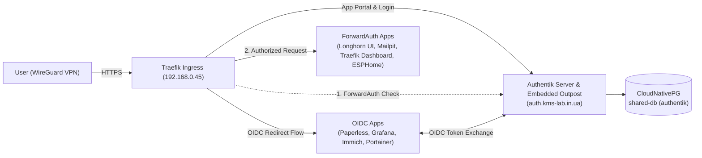

# ADR 039: Self-Hosted SSO & Identity Provider (Authentik)

**Status:** Accepted
**Date:** 2026-10-18
**Related Docs:** [[002-networking-and-ingress]], [[008-cloudnativepg-migration]], [[010-gatus-auto-discovery]], [[035-hybrid-zone-workload-policy]]

## Context

The cluster and QNAP NAS host a growing number of self-hosted services (`Paperless-ngx`, `Grafana`, `Open WebUI`, `Immich`, `Tandoor`, `LubeLogger`, `Longhorn UI`, `Mailpit`, `Jellyfin`, `*arr` stack). Managing independent credentials per application creates password sprawl, while internal administrative UIs (`Longhorn UI`, `Mailpit`) lack built-in authentication altogether.

We want an Okta-like centralized Identity Provider (IdP) and Application Portal that provides:
- A single application dashboard (launchpad) showing assigned apps per user/group.
- Strong authentication (Passkeys / WebAuthn / MFA).
- Native OpenID Connect (OIDC / OAuth2) integration for modern web applications.
- Traefik `ForwardAuth` proxy protection for services without native auth or with external proxy auth support (`*arr` stack).
- Phased, zero-downtime rollout starting strictly inside the WireGuard VPN (`auth.kms-lab.in.ua`).

## Decision

1. **Deploy Authentik (`2026.8.4`) in the `home` Zone (`workload/authentik.tf`, `workload/helm_values/authentik.yaml`)**:
   - **Database:** Backed by the existing CloudNativePG `shared-db` cluster (`authentik` role and database in `cnpg-system`). Modern Authentik (2025.2+) uses PostgreSQL for both persistence and background task queues/caching, requiring no Redis dependency.
   - **Placement:** Pinned to `topology.kubernetes.io/zone: home` per [[035-hybrid-zone-workload-policy]] to leverage local Proxmox RAM capacity (`384Mi` request / `768Mi` limit each for `server` and `worker`).
   - **Ingress & Network Exposure (Phase 1):** Exposed at `https://auth.kms-lab.in.ua` via Traefik. Because `auth.kms-lab.in.ua` is not added as a public Cloudflare Tunnel CNAME in `workload/cloudflare.tf`, it resolves via the wildcard A record (`10.9.0.1`) exclusively inside the WireGuard VPN.
   - **SMTP Testing Integration:** Configured to route outbound emails through the in-cluster Mailpit service (`mailpit.apn.svc.cluster.local:1025`).

2. **Pre-Provision Traefik Cross-Namespace ForwardAuth Middleware**:
   - Enabled `providers.kubernetesCRD.allowCrossNamespace = true` in `workload/infrastructure.tf`.
   - Created a reusable `Middleware` (`default/authentik-forwardauth`) pointing to Authentik's embedded proxy outpost (`http://authentik-server.default.svc.cluster.local:80/outpost.goauthentik.io/auth/traefik`).
   - Individual Ingresses can opt into proxy protection incrementally by adding the annotation `traefik.ingress.kubernetes.io/router.middlewares: default-authentik-forwardauth@kubernetescrd`.

## Rollout Phases

- **Phase 1 (Completed):** Deploy Authentik (`auth.kms-lab.in.ua`) over VPN and complete initial administrator setup (`/if/flow/initial-setup/`) + Passkey enrollment.
- **Phase 2 (Completed — Core Declarative Blueprint Rollout):**
  - Provisioned `workload/helm_values/authentik_blueprint.yaml` via `kubernetes_secret.authentik_blueprints` (`blueprints.secrets` in `workload/helm_values/authentik.yaml`).
  - **Paperless-ngx (`workload/paperless.tf`, `workload/helm_values/paperless.yaml`):** Connected via native OIDC (`allauth.socialaccount.providers.openid_connect`) with superuser group sync (`authentik Admins`), keeping regular login and API tokens active for the iOS app and Paperless MCP server.
  - **Grafana (`workload/victoriametrics.tf`, `workload/helm_values/victoriametrics.yaml`):** Connected via native `auth.generic_oauth` with automatic `GrafanaAdmin` role assignment for `authentik Admins`.
  - **Longhorn UI (`workload/infrastructure.tf`) & Mailpit (`workload/mailpit.tf`):** Protected via Traefik `ForwardAuth` (`default-authentik-forwardauth@kubernetescrd`) bound to Authentik's Embedded Outpost.
- **Phase 3 (Current — Extended Cluster & Infrastructure Rollout):**
  - **Immich (`workload/immich.tf`, `workload/helm_values/immich.yaml`):** Connected via native OIDC (supporting both Web and Mobile `app.immich:///oauth-callback`). Configured declaratively via a PostgreSQL `initContainer` (`configure-oauth`) that merges the `oauth` object into `system_metadata` (`key = 'system-config'`) so the Immich Admin UI remains editable.
  - **Traefik Dashboard (`workload/infrastructure.tf`) & ESPHome (`workload/helm_values/esphome.yaml`):** Protected via Traefik `ForwardAuth` (`default/authentik-forwardauth`) and added to the Authentik application portal.
  - **Portainer (`qnap/main.tf`):** Automated in a dedicated Terraform state (`terraform/state/qnap`) via the official `portainer/portainer` provider (`portainer_settings` with `authentication_method = 3` and `portainer_user.akadmin` with `role = 1` Administrator) using the API token from Bitwarden Secrets (`7e8d123d-5b32-49e0-b4a3-b4e701249afd`).
- **Phase 4 (Future):** Optional expansion to remaining workloads (`Open WebUI`, `Tandoor`, `LubeLogger`, `Jellyfin` SSO plugin, `*arr` `External` auth).

## Consequences

- **Pros:** Unified Okta-style application launchpad and single sign-on with WebAuthn/Passkeys; zero impact on existing services during initial deployment; reuses existing CNPG HA database and backups.
- **Cons:** Adds ~700–900 MiB total RAM footprint on the `home` zone nodes.
