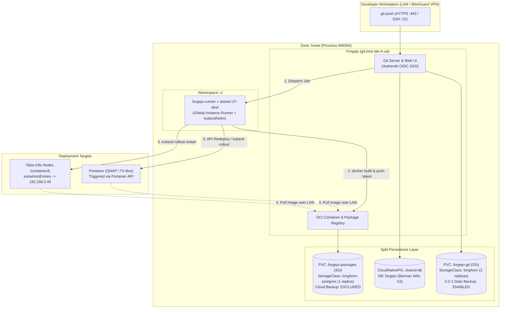

# ADR 040: Self-Hosted Forgejo (Git Server, OCI Container Registry & Global CI Runner)

**Status:** Implemented / Active
**Date:** 2026-10-20
**Related Docs:** [[002-networking-and-ingress]], [[003-storage]], [[008-cloudnativepg-migration]], [[027-apn-pr-preview-and-ci-runner]], [[035-hybrid-zone-workload-policy]], [[036-disaster-recovery-runbook]], [[039-authentik-sso-idp]]

## Context

As the number of internal and pet projects grows (`shopping-master`, `freelingo`, `htram-web`, `biopass`, `intercom`), hosting every project on GitHub personal repositories creates recurring operational friction:
1. **Per-Repository Runner Silos:** Personal GitHub accounts do not support organization-wide self-hosted runners (`workload/ci_runner.tf` had to hardcode `REPO_URL = "https://github.com/reidMaks/APN"`).
2. **Container Registry Sprawl:** Every project pushed to `ghcr.io` required generating personal access tokens, storing them in Bitwarden, and injecting `imagePullSecrets` across Kubernetes namespaces or Portainer stacks.
3. **WAN Hairpinning for Local Builds:** Building images in the cloud and pulling them back to local Proxmox (`home`) nodes or the QNAP NAS / TV-box wastes bandwidth and slows down the inner development loop.

We need a lightweight, unified, self-hosted platform inside the cluster that provides Git hosting, an OCI Container & Helm Registry, and a global instance-level CI/CD runner while keeping `IaaC` on GitHub for out-of-band Disaster Recovery and Renovate Bot automation ([[034-renovate-gitops-updates]]).

## Architecture & Topology

## Key Decisions

### 1. Unified Platform (`codeberg.org/forgejo/forgejo:17.0.0`) in `zone: home`
- Deployed via `app-template` in `workload/forgejo.tf` and `workload/helm_values/forgejo.yaml`, pinned to `topology.kubernetes.io/zone: home`.
- **Database:** Backed by the existing HA CloudNativePG `shared-db` cluster (`forgejo` role and database in `cnpg-system`), inheriting continuous 5-minute WAL archiving and nightly Barman backups to S3 $\rightarrow$ QNAP $\rightarrow$ Google Drive.
- **Authentik OIDC SSO:** Integrated declaratively via `workload/helm_values/authentik_blueprint.yaml` (`client_id: forgejo`, auto-discovery URL `https://auth.kms-lab.in.ua/application/o/forgejo/.well-known/openid-configuration`) and a `postStart` bootstrap hook that automatically registers the OIDC source and initial administrator account (`max`).

### 2. Split Persistence Strategy (Protecting Cloud Backup Quotas)
- **Git Repositories & SSH Keys (`forgejo-git` PVC, `2Gi`, `storageClass: longhorn`):**
  - Mounted at `/data` and labeled on the Longhorn `Volume` CR with `recurring-job-group.longhorn.io/daily-backups = "enabled"`.
  - Ensures all source code repositories are replicated across two `home` nodes and included in the nightly 3-2-1 backup pipeline ([[036-disaster-recovery-runbook]]).
- **Container Registry Blobs, Packages, LFS & CI Artifacts (`forgejo-packages` PVC, `3Gi`, `storageClass: longhorn-postgres`):**
  - Mounted via `subPath` into `/data/packages`, `/data/actions_artifacts`, `/data/actions_log`, and `/data/lfs`.
  - Intentionally **excluded** from Longhorn S3 backups so multi-hundred-megabyte Docker image layers do not traverse the WAN to OCI `minio-0` or consume encrypted Google Drive storage. Can be expanded online via Terraform as needed.

### 3. Strictly Internal Exposure (VPN/LAN Only) for Web, Registry & Git SSH
- **HTTPS (`443`):** Exposed at `https://git.kms-lab.in.ua` via Traefik (`192.168.0.45`) using the wildcard Let's Encrypt certificate (`kms-lab-tls`). Not added to `workload/cloudflare.tf`, keeping it unreachable from the public internet.
- **Git SSH (`22`):**
  - Forgejo runs its built-in Go SSH server on container port `2222` (`FORGEJO__server__START_SSH_SERVER = "true"`).
  - Traefik exposes a dedicated TCP entrypoint `git-ssh` on external port `22` (`192.168.0.45:22`) routed via an `IngressRouteTCP` (`forgejo-ssh`).
  - Inside `wg-hub` (`workload/wg_hub.tf`), a `socat` sidecar (`ingress-22`) forwards `10.9.0.1:22` (strictly inside the `wg0` tunnel interface, with no `host_port` on the OCI node) to `traefik.traefik-system.svc.cluster.local:22`.
  - Result: `git@git.kms-lab.in.ua:max/<repo>.git` works identically over home LAN and remote WireGuard VPN, while port `22` remains 100% closed to the public internet.
- **Node-Level Local DNS (`infra/talos.tf`):**
  - Added `extraHostEntries` mapping `git.kms-lab.in.ua` to `192.168.0.45` across Talos nodes so `containerd` pulls images directly from Traefik over the local LAN/KubeSpan without routing through the `10.9.0.1` WireGuard tunnel.

### 4. Global Instance-Level CI/CD Runner (`workload/ci_runner.tf`)
- Deployed `forgejo-runner` (`data.forgejo.org/forgejo/runner:13.1.0`) alongside a `docker:27-dind` sidecar in namespace `ci` (`zone: home`, `amd64`).
- **Zero-Touch Registration:** Terraform generates a deterministic 40-character hexadecimal runner secret shared between `forgejo` (`forgejo forgejo-cli actions register`) and `forgejo-runner` (`/data/config.yml`), registering the runner globally for all Forgejo repositories on first boot.
- **CD Workflow Pattern:**
  - Infrastructure for pet projects (`shopping-master` in Portainer `qnap/`, or services in K8s `workload/`) is provisioned once via Terraform in `IaaC` (with `lifecycle { ignore_changes = [env] }` on Portainer stacks so Terraform does not overwrite runtime secrets).
  - Application secrets for Portainer-hosted pet projects are stored directly in Forgejo Actions Secrets (`PORTAINER_API_KEY` once at the User level and a single multiline `ENV_FILE` secret per repository) rather than polluting Bitwarden Secrets Manager with per-project `.env` variables.
  - On `git push`, `forgejo-runner` builds and pushes multi-arch (`linux/amd64,linux/arm64`) images to `git.kms-lab.in.ua/max/<app>:latest` and triggers an immediate rollout via the Portainer API (`PUT /api/stacks/{id}` with parsed `Env` and `PullImage: true`, injected via `env_file: [stack.env]`) or `kubectl rollout restart` (via scoped RBAC in `default` and full sandbox autonomy in `apps`).
  - **Example (`shopping-master` Telegram Mini App):** Hosted on Portainer Endpoint 8 (`aml-s9xx-box`, `192.168.0.106:8080`) via `qnap/shopping-master/docker-compose.yml` (`WEBAPP_URL=https://shopping.kms-lab.in.ua`, `WEBAPP_PORT=8080`) and exposed on `https://shopping.kms-lab.in.ua` via Traefik (`workload/shopping_master.tf`) using a lightweight `home`-zone `socat` forwarder (`shopping-master-proxy`) that bridges KubeSpan overlay traffic from OCI Traefik to `192.168.0.106:8080`.

## Consequences
- **Pros:** Zero per-project GitHub runner or GHCR setup; 100% LAN-speed container builds and image pulls; source code automatically protected by 3-2-1 backups without Docker layer bloat in cloud backups.
- **Cons:** Adds ~350–500 MiB combined steady-state RAM footprint (`forgejo` + `forgejo-runner` + `dind`) in the `home` zone.
