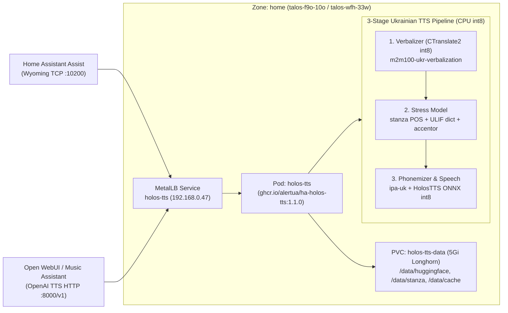

# 041 Ukrainian TTS Migration: Wyoming Piper to HolosTTS (`ha-holos-tts`)

**Status:** Accepted
**Date:** 2026-10-22
**Related Docs:** [[003-storage]], [[012-add-open-webui]], [[034-renovate-gitops-updates]], [[035-hybrid-zone-workload-policy]]

## Context

Previously, Home Assistant Assist used `lscr.io/linuxserver/piper` (`wyoming-piper` with the `uk_UA-tetiana-high` model) on MetalLB IP `192.168.0.47:10200` (`workload/piper.tf`). While lightweight (~352 MiB RAM), Piper had three significant limitations for Ukrainian smart-home announcements and voice interactions:
1. **No Text Verbalization:** Numbers, times, negative temperatures, percentages, and abbreviations (e.g., `"о 15:30, -3°C, вологість 87%"`) were passed raw into the phoneme converter, producing unnatural or broken pronunciation.
2. **Frequent Stress (Accent) Errors:** Homographs and complex Ukrainian inflections lacked part-of-speech contextual stress disambiguation.
3. **Single Protocol & Voice:** Exposed only the raw TCP Wyoming interface (`:10200`) with a single robotic VITS voice (`tetiana-high`), offering no OpenAI-compatible HTTP TTS endpoint for cluster AI services (`open-webui`, `litellm`) or Music Assistant.

## Decision

We replaced `piper` with **`ha-holos-tts`** (`ghcr.io/alertua/ha-holos-tts:1.1.0`, managed in `workload/holos_tts.tf`), which packages Serhiy Stetskovych's (`patriotyk`) **HolosTTS** model with a 3-stage Ukrainian text-preparation pipeline:

### Key Architectural Details
1. **3-Stage Ukrainian NLP + Speech Pipeline:**
   - **Verbalizer (`VERBALIZE=1`):** Runs `skypro1111/m2m100-ukr-verbalization-ct2` (CTranslate2 `int8`) on sentences containing digits, symbols, Latin letters, or acronyms, expanding `"о 15:30, -3°C"` into `"о пʼятнадцятій тридцять, мінус три градуси Цельсія"`.
   - **Contextual Stress Placement:** Combines `stanza` Ukrainian POS tagging (`UD_Ukrainian-IU`), the NASU ULIF stress dictionary (`ukrainian-word-stress`), and `ukrainian-accentor` for out-of-vocabulary words.
   - **Speech Synthesis (`HolosTTS` ONNX `int8`):** Provides 27 built-in voices (default `Speaker_67`, plus named voices such as `Гаська Шиян` and custom `.pt`/`.npy` cloned voices in `/data/voices`). Automatically detects CPU instruction flags and enables exact `session.x64quantprecision` on x86 CPUs without VNNI.
2. **Dual Protocol Exposure (`192.168.0.47`):**
   - `10200/TCP` (`wyoming`): Drop-in replacement for Home Assistant's native Wyoming integration.
   - `8000/TCP` (`http`): OpenAI-compatible `/v1/audio/speech` & `/v1/audio/voices` API, `/v1/warmup` preloader, and `/health` probe endpoint.
   - `WEB_UI=0` by default to avoid loading Gradio (~80 MiB RAM and 5–8% idle CPU polling overhead).
3. **Storage & Security Context (`holos-tts-data`):**
   - Provisioned a `5Gi` Longhorn `ReadWriteOnce` PVC (`holos-tts-data`) mounted at `/data` to store ~2.5 GB of Hugging Face / Stanza weights and ~880 MB of compiled ONNX / `int8` cache (~3.4 GB total).
   - Configured pod `security_context` (`run_as_user = 1000`, `run_as_group = 1000`, `fs_group = 1000`) because the container runs strictly as non-root `1000:1000` (`appuser`) and requires write access to initialize `/data` on first boot.
   - Configured `strategy.type = "Recreate"` to prevent `Multi-Attach` conflicts on the `ReadWriteOnce` volume and avoid overlapping 1.5+ GiB model-loading memory spikes during rollouts.
   - Added Terraform `moved` blocks from `piper` / `piper_data` to `holos_tts` / `holos_tts_data` so Terraform cleanly destroys the old `piper` Deployment, PVC, and MetalLB Service before provisioning `holos-tts` on `192.168.0.47`.

## Consequences
- **Pros:** Natural Ukrainian prosody, accurate stress disambiguation, automatic verbalization of smart-home telemetry (times, dates, temperatures, percentages), 27 voices + voice cloning support, and an OpenAI-compatible HTTP TTS endpoint alongside Wyoming.
- **Cons / Trade-offs:** Higher memory footprint (~1.5 GiB steady-state RSS, capped at `4608Mi` to accommodate cgroup v2 page cache and the 1.9 GB float32-to-int8 verbalizer cache build on first start, with `glibc` arena tuning `MALLOC_ARENA_MAX=2` and `MALLOC_TRIM_THRESHOLD_=65536`) and ~1.3s synthesis latency on CPU compared to ~352 MiB and ~0.2s for Piper. Both `home` worker nodes (`talos-f9o-10o` and `talos-wfh-33w`, 12 GiB RAM each at ~53% utilization) have ample memory headroom.
