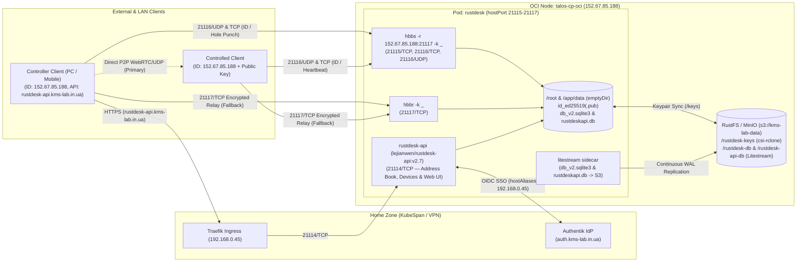

# ADR 042: Self-Hosted RustDesk Rendezvous, Relay & API Server (`hbbs` / `hbbr` / `rustdesk-api`)

**Status:** Accepted
**Date:** 2026-10-28
**Related Docs:** [[001-hybrid-cluster]], [[002-networking-and-ingress]], [[009-litestream-sqlite-integration]], [[035-hybrid-zone-workload-policy]], [[036-disaster-recovery-runbook]], [[039-authentik-sso-idp]]

## Context

In 2026, the public RustDesk server (`rs-ny.rustdesk.com`) began enforcing mandatory third-party account authentication for controllers (and potentially controlled devices) due to widespread botnet and scammer abuse. Relying on the shared public demonstration infrastructure introduces availability risks, rate-limiting, and third-party account dependencies during remote support sessions.

Because our hybrid Kubernetes cluster includes an Always-On Oracle Cloud (`zone: oci`) node (`talos-cp-oci`) with a dedicated static public IPv4 address (`152.67.85.188`) and 10 TB/month of free outbound bandwidth, we can self-host `rustdesk-server` (`hbbs` and `hbbr`) together with the community API & Address Book server (`lejianwen/rustdesk-api`) directly in the cloud survivor tier with zero monthly cost.

## Decision

We deploy **RustDesk Server OSS (`rustdesk/rustdesk-server:1.1.16`)** alongside **RustDesk API Server (`lejianwen/rustdesk-api:v2.7`)** in the `default` namespace pinned to `talos-cp-oci` (`workload/rustdesk.tf` and `workload/helm_values/rustdesk.yaml`), integrated with **Authentik SSO (`auth.kms-lab.in.ua`)** via OpenID Connect (OIDC).

### 1. Network, Firewall & Routing
- **OCI VCN Security List (`infra/oci.tf`):** Opened ingress rules on `k8s-sl` for `21115–21117/TCP` and `21116/UDP` from `0.0.0.0/0`. WebSocket ports (`21118–21119/TCP`) are intentionally kept closed to prevent `X-Forwarded-For` / `X-Real-IP` spoofing.
- **Direct Public IP for Rendezvous/Relay (`152.67.85.188`):** Because the home router (`192.168.0.1`) authoritatively resolves all `*.kms-lab.in.ua` domains to `10.9.0.1` (`wg-hub`), `hbbs` and client configurations use the raw static IP `152.67.85.188` for ID/Relay traffic so LAN and external clients reach `talos-cp-oci` directly without DNS overrides.
- **API & Web Admin Ingress (`rustdesk-api.kms-lab.in.ua`):** Exposed on port `21114/TCP` behind Traefik (`https://rustdesk-api.kms-lab.in.ua`), accessible across LAN and WireGuard VPN (`*.kms-lab.in.ua -> 10.9.0.1`).
- **HostPort Binding:** `hbbs` binds `hostPort` `21115/TCP`, `21116/TCP`, and `21116/UDP`; `hbbr` binds `hostPort` `21117/TCP` on `talos-cp-oci`, preserving real client source IPv4 addresses and UDP ports required for NAT hole-punching.

### 2. Mandatory Key Enforcement (`-k _`) & Bandwidth Limits
- Note: `rustdesk/rustdesk-server:1.1.16` is a `FROM scratch` image without `/bin/sh`, so `hbbs` and `hbbr` are invoked directly (`hbbs -r 152.67.85.188:21117 -k _` and `hbbr -k _`).
- Relay bandwidth is capped on `hbbr` via `SINGLE_BANDWIDTH=16` (16 Mb/s per session) and `TOTAL_BANDWIDTH=64` (64 Mb/s aggregate), alongside container CPU limits (`250m`), memory limits (`128Mi`), and `allowPrivilegeEscalation: false`.

### 3. RustDesk API Server (`lejianwen/rustdesk-api:v2.7`) & Authentik OIDC SSO
- **Address Book & Device Management:** Runs as the `api` container inside the `rustdesk` pod, providing cloud Address Book synchronization, Tags, Device status tracking, Web Admin (`https://rustdesk-api.kms-lab.in.ua/_admin/`), and Web Client (`https://rustdesk-api.kms-lab.in.ua/webclient/`).
- **Declarative Authentik OIDC Integration (`workload/authentik.tf`, `workload/helm_values/authentik_blueprint.yaml`):**
  - Provisioned `provider-rustdesk` (`client_id: rustdesk`, redirect URI `https://rustdesk-api.kms-lab.in.ua/api/oidc/callback`) and `app-rustdesk` (`https://rustdesk-api.kms-lab.in.ua/_admin/`).
  - Configured `hostAliases` (`192.168.0.45` -> `auth.kms-lab.in.ua`, `rustdesk-api.kms-lab.in.ua`) on the `rustdesk` pod so `rustdesk-api` on `talos-cp-oci` reaches Authentik over KubeSpan.
  - On container startup, a `postStart` hook in `api` synchronizes the admin password from `rustdesk-api-secret`, sets the `admin` (`id=1`) email to `reid.maks@gmail.com` (so Authentik OIDC login automatically binds to the primary `admin` account), and creates/updates the `Authentik` OIDC provider (`PKCE S256`, `auto_register: true`).

### 4. Stateful Persistence & 3-2-1 Disaster Recovery
Because Longhorn block scheduling is disabled on OCI nodes, `rustdesk` uses the standard OCI survivor storage pattern:
- **`/root` & `/app/data` (`emptyDir`):** Mounted from the same `data` volume onto `/root` (`hbbs`/`hbbr`/`litestream`) and `/app/data` (`rustdesk-api`), providing native local ext4 storage on `talos-cp-oci` for both `db_v2.sqlite3` and `rustdeskapi.db`.
- **Ed25519 Keypair Persistence (`rustdesk-keys-s3` via `csi-rclone`):** Mounted at `/keys` (`s3://kms-lab-data/rustdesk-keys`). `00-keys-restore` (`litestream/litestream:0.5.17`) restores `id_ed25519` and `id_ed25519.pub` from `/keys` before `hbbs` starts, while `litestream`'s `postStart` hook backs up newly generated keys to `/keys`.
- **Dual SQLite Replication (`litestream` sidecar):** `01-litestream-restore` restores both `/root/db_v2.sqlite3` and `/root/rustdeskapi.db` on pod initialization, and the `litestream` sidecar continuously replicates both databases to `s3://kms-lab-data/rustdesk-db` and `s3://kms-lab-data/rustdesk-api-db` (mirrored to QNAP NAS and encrypted Google Drive via `qnap-sync`).

### 5. Client Provisioning Helper (`just rustdesk-config`)
`just rustdesk-config` in the root `justfile` outputs the `ID Server`, `API Server`, `Public Key`, and the reversed Base64 configuration string (`{"host":"152.67.85.188","key":"...","api":"https://rustdesk-api.kms-lab.in.ua"}`) for one-click client import (`sudo rustdesk --config <string>` on Linux or QR/string import on mobile).

## Consequences
- **Pros:** Zero dependency on public RustDesk servers; full Authentik SSO (Passkey / Face ID) login on PC, mobile, and Web Admin; synchronized Address Book across all devices; 24/7 availability in `zone: oci` with full 3-2-1 S3 backup durability.
- **Cons:** Both controller and controlled clients must import the server configuration string (`host` + `key` + `api`).
