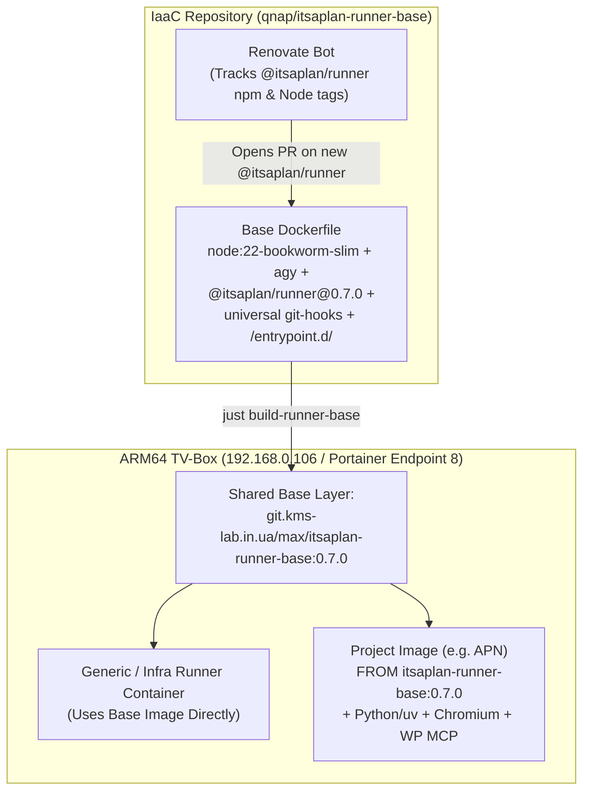

# 044 Shared Base Image Architecture for Multi-Project "It's a Plan" Agent Runners

**Status:** Accepted
**Date:** 2026-10-30
**Related:** [[024-itsaplan-ai-issue-tracker]], [[034-renovate-gitops-updates]], [[040-forgejo-git-and-container-registry]]

## Context

Autonomous AI coding and content agents connected to **It's a Plan** (`plan-api.kms-lab.in.ua`) execute on the dedicated ARM64 micro-server (`aml-s9xx-box`, `192.168.0.106`, Portainer Endpoint `8`).

Previously, the entire agent runner image (`Dockerfile`, `entrypoint.sh`, `git-hooks`) was defined inside the `APN` application repository (`APN/deploy/aml-box-runner/`) and installed `@itsaplan/runner` without a version pin (`RUN npm install -g @itsaplan/runner`). This caused two issues:
1. **Stale Runner CLI:** Docker layer caching kept `@itsaplan/runner` frozen at `0.5.2` even after upstream released `0.7.0` (which added external agent run transcripts in the UI, final trace retry resilience `#648`, timeout propagation `#530`, and CLI flag injection protection `GHSA-x99f-4j7w-gvh9`).
2. **Duplication Across Projects:** As additional projects (`IaaC`, `shopping-master`, and future repositories) adopt autonomous agents, duplicating an 80-line `Dockerfile` with Node.js, Antigravity CLI (`agy`), `@itsaplan/runner`, and Git hooks in every repository creates maintenance drift and wastes storage on the TV-Box's 28 GB eMMC disk.

## Architecture & Topology

## Decision

1. **Centralized Base Runner Image (`qnap/itsaplan-runner-base/`):**
   - Maintained in the `IaaC` repository and built via `just build-runner-base` as `itsaplan-runner-base:<VERSION>` / `git.kms-lab.in.ua/max/itsaplan-runner-base:<VERSION>`.
   - Contains the shared foundation needed by every agent across all projects:
     - `node:22-bookworm-slim`, `git`, `curl`, `jq`, `openssh-client`, `gettext-base` (`envsubst`).
     - Google Antigravity CLI (`agy`).
     - Version-pinned `@itsaplan/runner@0.7.0` (`ARG RUNNER_VERSION=0.7.0`), tracked automatically by Renovate via a custom regex manager in `renovate.json`.
     - Base MCP bridges (`mcp-remote`, `mcp-searxng`).
2. **Universal Git Safety Guardrails (`/etc/git-hooks`):**
   - `pre-push`: Blocks direct pushes to `refs/heads/main` and `refs/heads/master` across all repositories unless `ALLOW_MAIN_PUSH=1`, then delegates to any repository-local `.githooks/pre-push` or `.git/hooks/pre-push`.
   - `pre-commit`: Dynamically resolves `git rev-parse --show-toplevel` and dispatches to the active repository's `.githooks/pre-commit` or `.git/hooks/pre-commit`.
3. **Extensible Entrypoint (`/entrypoint.sh` & `/entrypoint.d/*.sh`):**
   - Configures SSH deploy keys (`/etc/ssh-keys`), populates `known_hosts` for `github.com` and `git.kms-lab.in.ua`, and verifies `@itsaplan/runner` against `RUNNER_VERSION` (supporting instant runtime upgrades via environment variable without rebuilding child images).
   - Supports rendering `itsaplan-runner.json.tmpl` via `envsubst` so per-agent API keys can be injected via Portainer environment variables.
   - Sources any `/entrypoint.d/*.sh` hooks added by project-specific child images before invoking `exec itsaplan-runner`.
4. **Layered Project Extension Pattern:**
   - Projects requiring specialized toolchains (e.g. `APN` with Python/`uv`, headless Chromium/Puppeteer, `gh`, and `mcp-wordpress`) extend `FROM git.kms-lab.in.ua/max/itsaplan-runner-base:0.7.0` and drop optional initialization scripts into `/entrypoint.d/`.
   - Projects requiring only `git`, `agy`, and standard MCP servers use `itsaplan-runner-base` directly without a custom `Dockerfile`.

## Consequences

- **Shared Docker Layers on eMMC:** All runner containers on `192.168.0.106` share the base OS, Node.js, `agy`, and `@itsaplan/runner` layers, minimizing disk usage on the 28 GB TV-Box.
- **Automated Version Tracking:** Renovate tracks `@itsaplan/runner` releases in `qnap/itsaplan-runner-base/Dockerfile`, and `RUNNER_VERSION` can also be bumped at container startup.
- **Zero Per-Repo Boilerplate:** Child repositories no longer duplicate `entrypoint.sh` or global `git-hooks`.
